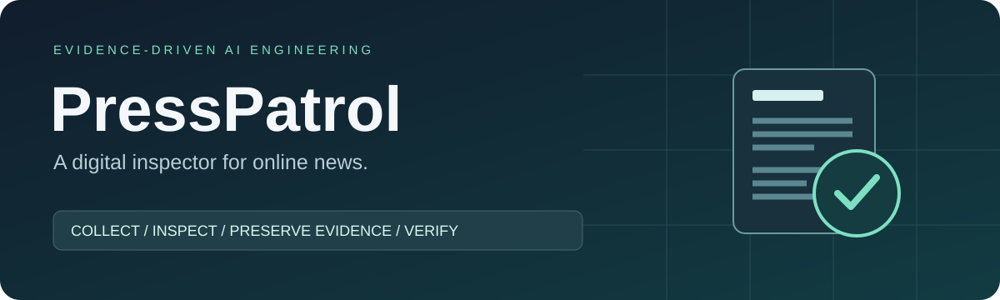
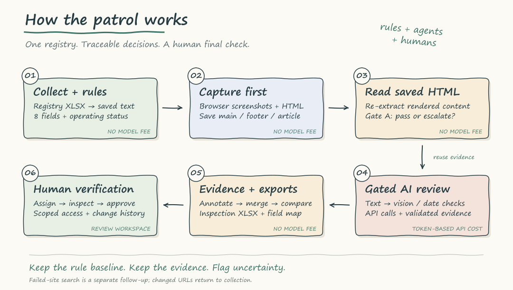

<div align="center">



# PressPatrol
**A digital inspector for online news.**

An evidence-driven AI pipeline for auditing digital news compliance.

[한국어](README.ko.md) · [Pipeline](ver_1/skill/README.md) · [Rules](ver_1/skill/references/README.md) · [Agents](ver_1/skill/agents/README.md) · [Costs](ver_1/skill/COSTS.md) · [Review UI](ver_1/review_ui/README.md)

</div>

## From a spreadsheet to a reviewable decision

PressPatrol supports inspections under Korea's **Act on the Promotion of Newspapers, etc. and its Enforcement Decree**, focusing on website operation and mandatory disclosures under Article 21. Rules, API agents, and saved evidence produce preliminary findings; **a human reviewer must recheck the evidence and make the final determination**.



- **Rules first:** eight disclosure fields, explicit cross-field rules, and a frozen rule baseline.
- **Evidence alongside AI:** saved HTML, screenshots, verbatim checks, field locations, and audit trails.
- **People in the loop:** reviewer assignments, scoped access, staged approvals, conflict checks, and history.

## Try it without an API key

Python 3.10+, from the repository root:

```powershell
python -m pip install -r requirements.txt
$env:PYTHONIOENCODING = "utf-8"
python news-audit-skill/tests/disclosure_fixture_e2e.py
python -m unittest discover -s ver_1/review_ui -p "test_*.py" -v
```

For a live run, follow [setup and API-key configuration](ver_1/skill/SETUP.md). The [20-record synthetic registry sample](examples/registry/README.md) preserves the input schema without original contact details; offline fixtures generate their own data.

## Explore the implementation

- [Pipeline and commands](ver_1/skill/README.md) · [script index](ver_1/skill/scripts/README.md)
- [Original implemented rules](ver_1/skill/references/README.md) · [rule engine](ver_1/skill/scripts/md_core/README.md)
- [API agents and their source](ver_1/skill/agents/README.md) · [unit costs and calculation limits](ver_1/skill/COSTS.md)
- [Human review workspace](ver_1/review_ui/README.md) · [architecture](docs/architecture.md) · [design decisions](docs/design-decisions.md) · [validation](docs/validation.md)

Reprocessing execution and final human-review XLSX integration remain unconnected. No reuse license has been selected.
